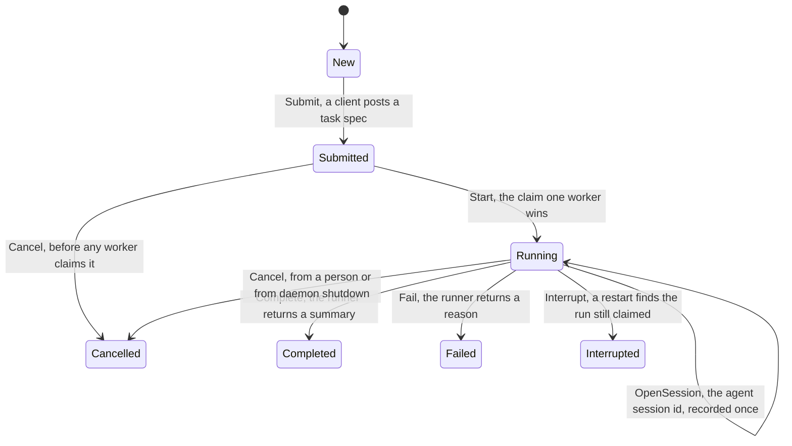
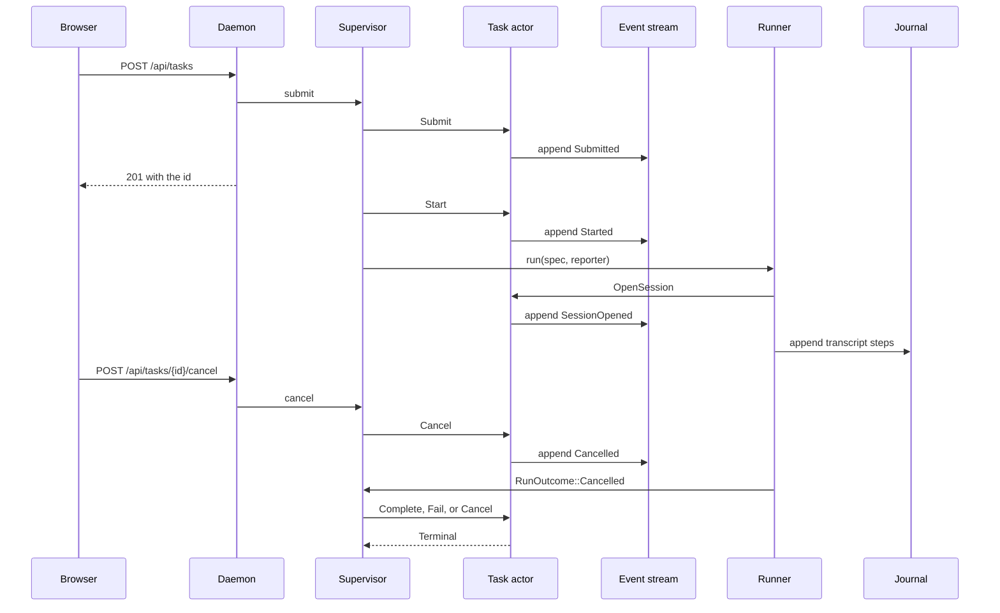
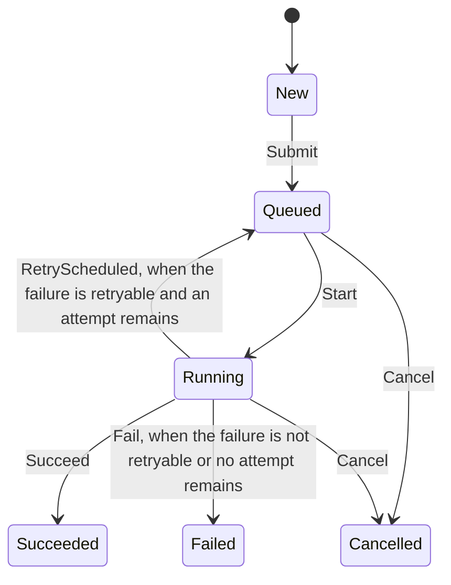

# Architecture

This document covers the two state machines in the workspace and the runtime that drives
the one the daemon serves. The flags, endpoints, and data layout live in
[README.md](README.md).

## Task lifecycle

The task machine lives in `crates/mokmok-control-core/src/task.rs`, and the rule it rests
on is that status is derived, never stored. `decide` turns a command into the events it
commits, `evolve` applies one event to a state, and `TaskState::replay` folds a log with
`evolve` alone.

`Completed`, `Failed`, `Cancelled`, and `Interrupted` carry no outgoing edge, so every
command they receive returns `Terminal`.

`SessionOpened` is a domain fact, not an unused leftover, and it is not a resume
handle. The runner records the ACP session id once through `Reporter::started` in
`crates/mokmok-control/src/supervisor.rs`, `GET /api/tasks/{id}` serves it as `session`,
and a second open is `SessionAlreadyOpen`. `AcpRunner` always opens a fresh session with
`new_session` in `crates/mokmok-control/src/runner.rs`; the ACP client has no
`session/load`, so nothing later reads that id to continue a turn. A run that never
opens a session stays `Running` without one, which the machine allows.

### States

| State | What it means for the task | How an operator sees it |
| --- | --- | --- |
| `New` | No submission is in the stream, so the task has no spec. | No listing row, and `GET /api/tasks/{id}` answers `404`. |
| `Submitted` | The spec is committed and no worker has claimed the task. | A listing row with status `submitted`, and a cancel the daemon accepts with `202`. |
| `Running` | One worker won `Start` and a runner is working on the task. | A listing row with status `running`. A cancel commits `Cancelled` at once and the runner stops at its next poll. |
| `Completed` | The runner returned a summary, which is the outcome. | A listing row with status `completed` and the summary, and a `409` on cancel. |
| `Failed` | The runner returned a reason, which is the outcome. | A listing row with status `failed` and the reason, and a `409` on cancel. |
| `Cancelled` | A person cancelled, or a shutdown did, and the reason is the outcome. | A listing row with status `cancelled` and the reason, and a `409` on cancel. |
| `Interrupted` | The control plane stopped while the task was running, and no process can finish it. | A listing row with status `interrupted` and the reason, and a `409` on cancel. |

### Transitions

| State left | Command | Event committed | State entered | Component that commits it |
| --- | --- | --- | --- | --- |
| `New` | `Submit` | `Submitted` | `Submitted` | `create_task` in `apps/mokmok-controld/src/lib.rs`, through `Supervisor::submit` |
| `Submitted` | `Start` | `Started` | `Running` | `Work::run_one` in `crates/mokmok-control/src/supervisor.rs` |
| `Submitted` | `Cancel` | `Cancelled` | `Cancelled` | `Supervisor::cancel`, through `cancel_task` |
| `Running` | `OpenSession` | `SessionOpened` | `Running` | `SystemReporter::started` in `crates/mokmok-control/src/supervisor.rs` |
| `Running` | `Complete` | `Completed` | `Completed` | `Work::settle` in `crates/mokmok-control/src/supervisor.rs` |
| `Running` | `Fail` | `Failed` | `Failed` | `Work::settle` in `crates/mokmok-control/src/supervisor.rs` |
| `Running` | `Cancel` | `Cancelled` | `Cancelled` | `Supervisor::cancel` from `cancel_task`, or `Work::settle` when a stopped runner returns `Cancelled` |
| `Running` | `Interrupt` | `Interrupted` | `Interrupted` | `Work::sweep` in `crates/mokmok-control/src/supervisor.rs`, at startup, for a run a previous process left claimed |

### Rejected commands

A rejected command commits nothing and leaves the stream where it was.

| Error | What it rejects | States where it applies |
| --- | --- | --- |
| `NotSubmitted` | Every command except `Submit`. | `New` |
| `AlreadySubmitted` | A second `Submit`. | `Submitted`, `Running` |
| `AlreadyStarted` | A second `Start`. | `Running` |
| `NotRunning` | `OpenSession`, `Complete`, `Fail`, or `Interrupt` before `Start`. | `Submitted` |
| `SessionAlreadyOpen` | A second `OpenSession` on a task that already holds a session. | `Running` |
| `Terminal` | Every command. | `Completed`, `Failed`, `Cancelled`, `Interrupted` |

`Submit` on an invalid spec returns `InvalidSpec` and commits nothing. The task actor in
`handle` in `crates/mokmok-control/src/system.rs` returns `WrongTaskId` before `decide`
runs when a spec names another stream. `Work::settle` treats `Terminal` from the runner's
own outcome as success, because a person can cancel mid-run.

### The update event that no command produces

`ControlEvent::UpdateRecorded` exists for task logs written before the execution journal,
and only those logs carry it. `evolve` accepts the event only in `Running`, where it
appends to the bounded `updates` list and increments `update_count`. `TaskState::replay`
keeps it, so a legacy task still shows its transcript, and no command emits it today.

## How the runtime drives the machine

`create_task` and `cancel_task` in `apps/mokmok-controld/src/lib.rs` are the two doors into
the machine. Create calls `Supervisor::submit`, which commits `Submitted` before the id
reaches the caller, so a held id always names a stream that a restart can find. Cancel
reads the task through `ControlSystem::state` first and answers `409` for a task that is
already `Completed`, `Failed`, `Cancelled`, or `Interrupted`. The supervisor therefore only
sees a cancel the machine can still take.

`ControlSystem` in `crates/mokmok-control/src/system.rs` keeps one actor per task. A
command for a task with no live actor replays the stream, spawns the actor with the state
and version it read, and commits under that expected version. A `StoreError::Conflict`
closes the mailbox so the next command replays instead of queueing behind a stale state.
An idle actor retires after 60 seconds and the next command replays it. The lifecycle
stripe lock around a replay and a retirement is what stops a retiring actor from
committing behind a fresh replay.

`Supervisor` in `crates/mokmok-control/src/supervisor.rs` owns the queue. `Start` is the
fence, so exactly one worker runs a task and a worker that loses the race skips it.
`settle` maps a `RunOutcome` to `Complete`, `Fail`, or `Cancel`. A shutdown sets
`shutting_down`, so a cooperative runner ends `Cancelled`, queued tasks stay `Submitted`,
and a restart queues every `Submitted` task it finds.

Before a restart spawns any worker, `Work::sweep` asks `ControlSystem::recover` for the
streams a previous process left open and appends one `Interrupted` record to each task
still `Running`. That is the only way a task becomes `Interrupted`, and it is why a run
whose agent finished cannot be resumed: the sweep records the fact that no process
finished it, and a later outcome from a detached worker is refused as `Terminal`. The
session id on that stream is still only a trace: continue the work by submitting a new
task, not by loading the recorded session.

The runners in `crates/mokmok-control/src/runner.rs` are `ScriptedRunner`, `FailingRunner`,
and `AcpRunner`. `AcpRunner` maps `StopReason::EndTurn` to `Completed`,
`StopReason::Cancelled` to `Cancelled`, and every limit, refusal, protocol, or transport
error to `Failed`. `Work::run_one` catches a panicking runner and settles the task as
`Failed` with the reason `the runner panicked`.

The domain stream is the source of truth and the journal in
`crates/mokmok-journal/src/lib.rs` is display only. No reader of the journal passes a
record back to `evolve`, so losing a journal segment loses transcript lines and leaves
the task where it was. A task logged before the journal existed still serves its
transcript from its `UpdateRecorded` events.

## One run, end to end

The diagram follows one task from the create request through a human cancel that lands
while the agent still works.

A completed run commits four domain events, and replay folds those four once each. The
domain cost of a run does not grow with what the agent says. The transcript is not a
domain event, so a thousand streamed chunks cost journal bytes and never a replay step.

## Job lifecycle

`crates/mokmok-jobs-core/src/job.rs` holds a second event-sourced machine, `JobState`,
with its own `decide` and `evolve` over `JobCommand` and `JobEvent`. `RetryScheduled`
returns `Running` to `Queued` with the next attempt number, which is the one move the
task machine has no equivalent for. The daemon does not drive this machine today, and
nothing outside `mokmok-jobs-core` and `mokmok-jobs` uses it. The daemon imports only the
`mokmok-jobs-jsonl` and `mokmok-jobs-s3` adapters, which implement the generic event
store.

## Rules the code enforces

1. One actor per task writes the stream. `crates/mokmok-control/src/system.rs` gives each
   task id one thread, and every command for that id goes through that thread's mailbox,
   so two writers cannot interleave in one task's log.
2. Every append carries the expected version. `EventStore::append` in
   `crates/mokmok-events/src/port.rs` takes the version the writer read and returns
   `StoreError::Conflict` when the stream has moved past it.
3. The journal is never replayed. `crates/mokmok-journal/src/lib.rs` stores transcript
   records that only the read endpoints touch, so an edit there cannot change a status.
4. A run is one shot. `crates/mokmok-control/src/runner.rs` returns one `RunOutcome` from
   each `run` call, and a failed run ends `Failed` instead of starting again.
5. A restart resumes only `Submitted` tasks. `Supervisor::start` sweeps first:
   `Work::sweep` asks `ControlSystem::recover` for leftover work, appends
   `Interrupted` to each `Running` stream, and queues every `Submitted` task. A
   `Running` task is a lease the previous process held, not a run this process can
   finish. `SessionOpened` does not change that: the recorded session id is not
   loaded, so an `Interrupted` task has no continue-from-here path.
6. A cancel is a status change, and the runner learns it by polling. `AcpRunner::run` in
   `crates/mokmok-control/src/runner.rs` asks `Reporter::cancelled` every 50 milliseconds
   and cancels the agent turn when the answer is yes.

## Checking the diagram

`crates/mokmok-control-core/tests/architecture.rs` reads this file, parses the task
diagram, and rebuilds the edge set by walking `decide` and `evolve` from every status. A
command the machine accepts with no matching line fails the test, and so does a line the
machine cannot perform. Run it with `nix develop -c cargo test -p mokmok-control-core`.
